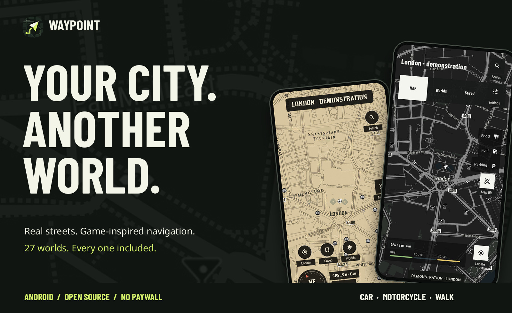
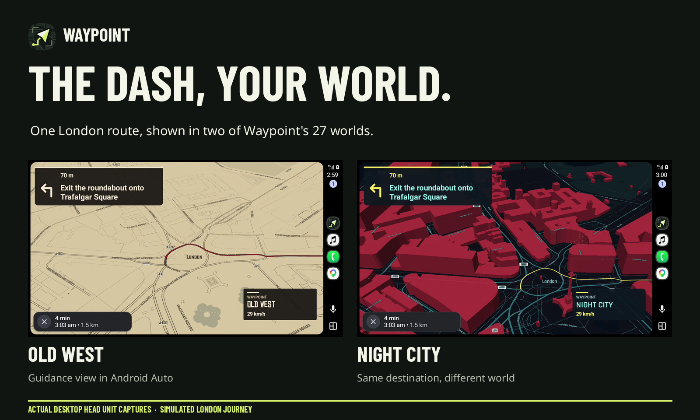
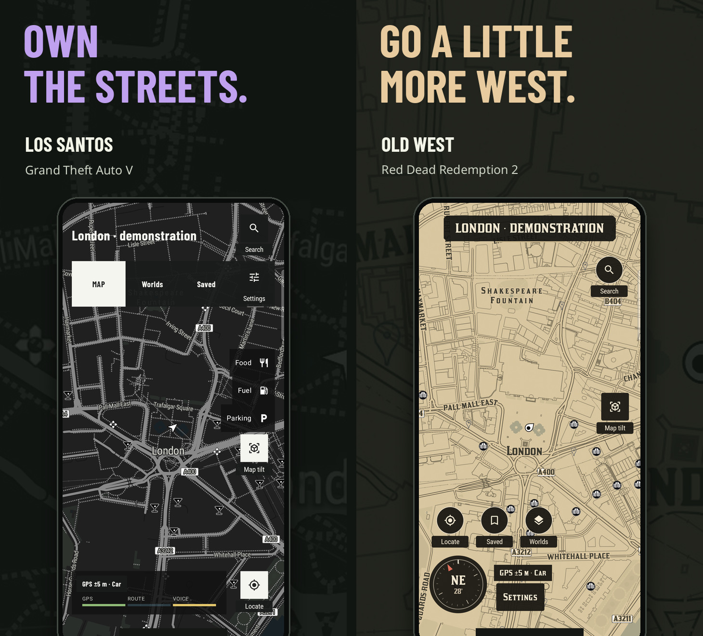
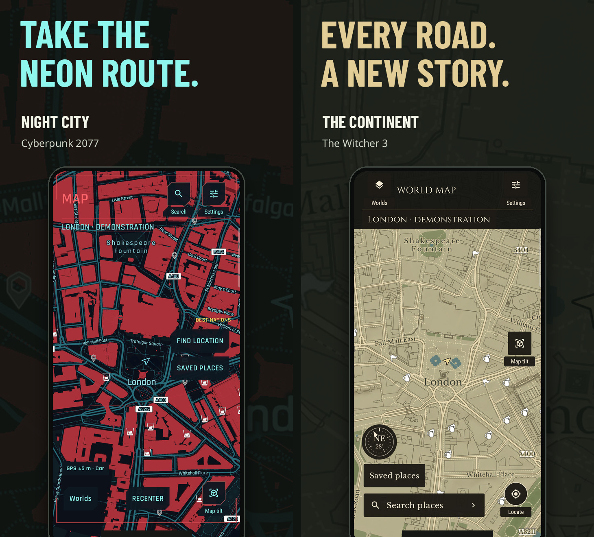
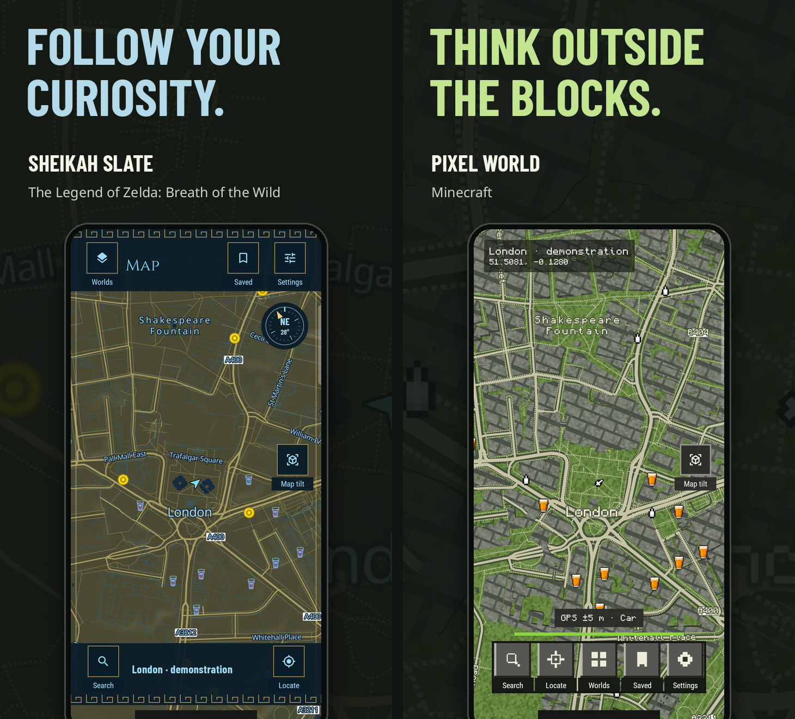

<div align="center">
  <picture>
    <source media="(max-width: 640px)" srcset="docs/images/promo/hero-mobile.jpg" />
    
  </picture>
  <p><strong>Real streets. Another world.</strong><br />27 game-inspired maps, live navigation and spoken directions on your phone and Android Auto.<br /><sub>Made in India · Open to the world</sub></p>
  <p>
    <a href="https://github.com/the-geeky-couldron/waypoint/releases/latest"></a>
    <a href="https://github.com/the-geeky-couldron/waypoint/releases"></a>
    <a href="https://github.com/the-geeky-couldron/waypoint/stargazers"></a>
  </p>
  <p><sub>GitHub release asset downloads; not unique installs.</sub></p>
  <p><a href="https://github.com/the-geeky-couldron/waypoint/releases/latest"></a></p>
  <p><a href="https://github.com/the-geeky-couldron/waypoint/releases/latest"><strong>Download the latest APK</strong></a> · <a href="#build-from-source">Build from source</a> · <a href="#privacy-and-services">Privacy and services</a></p>
  <p><sub>Android 8.0+ · No ads or paywall · No Waypoint account · Every world included</sub></p>
</div>

## Your world, on the dashboard

Connect your phone to Android Auto and open Waypoint from the car launcher. The projected map follows the world selected on your phone, with a full route line, turn cues and a camera that follows travel. Search or pick a saved destination on the car screen; shared destinations ask before Waypoint previews a route.

<picture>
  <source media="(max-width: 640px)" srcset="docs/images/promo/android-auto-mobile.jpg" />
  
</picture>

<sub>Captured in the Android Auto Desktop Head Unit with a fixed public London demonstration route. The route and guidance state were simulated for the screenshots; no personal location was used. <a href="docs/images/promo/README.md">Capture and artwork notes</a>.</sub>

**Waypoint 1.1.0** also brings Ferrostar guidance and rerouting, smoother phone and car map updates, better route-preview recovery, and refinements to Locate, tilt, search and the world gallery. [Read the full release notes](docs/releases/current.md).

Android Auto keeps Google Maps available in the launcher. Open Waypoint there to use it as the current navigation app; installing it cannot change Android Auto's choice on its own. The car UI uses host-safe controls for search, saved destinations, voice, recenter and zoom. The phone remains the place to choose Car, Motorcycle or Walk.

## Your map, your world

Pick a world during onboarding, then explore real geography through its roads, typography, markers and navigation controls. Switch styles without losing your destination. The globe, world gallery and map are designed as one journey; the map itself remains readable while you travel.

After the first run, Waypoint opens your last selected world. Thanks to [u/cuberisk](https://www.reddit.com/user/cuberisk/) for suggesting that faster return to the map.

<picture>
  <source media="(max-width: 640px)" srcset="docs/images/promo/worlds-1-mobile.jpg" />
  
</picture>

<picture>
  <source media="(max-width: 640px)" srcset="docs/images/promo/worlds-2-mobile.jpg" />
  
</picture>

<picture>
  <source media="(max-width: 640px)" srcset="docs/images/promo/worlds-3-mobile.jpg" />
  
</picture>

<sub>These compositions use sanitised native map captures at a fixed public London demonstration position. <a href="docs/images/promo/README.md">Artwork notes</a>.</sub>

<details>
<summary><strong>See all 27 worlds</strong></summary>

| World | Inspiration | World | Inspiration |
| --- | --- | --- | --- |
| Los Santos | Grand Theft Auto V | Old West | Red Dead Redemption 2 |
| Night City | Cyberpunk 2077 | Pixel World | Minecraft |
| Green Terminal | Fallout | San Andreas | Grand Theft Auto: San Andreas |
| Midnight Run | Need for Speed Heat | The Continent | The Witcher 3 |
| Vice Coast | Grand Theft Auto: Vice City | Liberty City | Grand Theft Auto IV |
| Nudle Maps | Watch Dogs 2 | Sheikah Slate | The Legend of Zelda: Breath of the Wild |
| Skyrim | The Elder Scrolls V: Skyrim | Lands Between | Elden Ring |
| Horizon | Forza Horizon | Animus | Assassin’s Creed Origins |
| Hope County | Far Cry 5 | Tsushima | Ghost of Tsushima |
| Bridges | Death Stranding | The Embrace | Horizon Zero Dawn |
| Manhattan | Marvel’s Spider-Man | Highlands | Hogwarts Legacy |
| Surface Map | Starfield | Bohemia | Kingdom Come: Deliverance II |
| Steelport | Saints Row: The Third | Medici | Just Cause 3 |
| Lost Heaven | Mafia: Definitive Edition | | |

</details>

## Built for the journey

- **Drive, ride or walk.** Choose a car, motorcycle or walking route, then follow spoken turns, remaining distance and ETA.
- **Take the route into the car.** Android Auto shows Waypoint's selected world, moving map, route and next turn. Search, saved destinations and map controls stay within the car's template UI.
- **Keep your bearings.** Locate recentres on your actual position; the map follows movement and can recalculate after a confirmed wrong turn. A 2D/3D control changes the camera tilt.
- **Find useful places.** Search destinations, drop a pin, and see world-specific blips for food, pubs, shops, schools, hospitals and other mapped places. Icons appear progressively as you zoom so dense streets stay legible.
- **Pick up where you left off.** Save places, revisit recent destinations and switch worlds during a trip. Shared `geo:` and `google.navigation:` links ask for confirmation before Waypoint looks up or previews the imported destination.
- **Send feedback in context.** Settings opens a draft GitHub issue with the current world and app version. You review it in your browser before submitting; a GitHub account is needed to post the issue.


## Get Waypoint

**[Download Waypoint.apk from GitHub Releases →](https://github.com/the-geeky-couldron/waypoint/releases/latest)**

1. Open the APK and follow Android’s installation prompts.
2. Complete onboarding, choose a world and open the map.
3. Tap **Locate** and grant precise location. Search for a destination or hold the map to drop a pin.
4. Choose **Car**, **Motorcycle** or **Walk**. Review the route, then tap **Start navigation**.

Installed versions check for a newer stable GitHub release when Waypoint opens on the phone. If an update is available, an in-app prompt appears when the idle map is visible. Review the release notes, choose **Download update**, and confirm installation in Android. The APK is checked against its checksum, package, version and installed signing identity. Waypoint shows What’s New once after a compatible update and keeps saved places and settings. This source tree is **Waypoint 1.1.0**; see the [release notes](docs/releases/current.md).

## Build from source

You need **JDK 17**, Android **SDK Platform 36** and **Build Tools 35.0.0**. Set `ANDROID_HOME` or put your SDK path in the ignored `local.properties` file.

```sh
git clone https://github.com/the-geeky-couldron/waypoint.git
cd waypoint
./gradlew :app:assembleDebug :app:testDebugUnitTest :app:lintDebug
adb install -r app/build/outputs/apk/debug/app-debug.apk
```

The Android build uses Kotlin, Jetpack Compose and MapLibre Native. No map API key, Node installation or Pillow (PIL) installation is needed to build the checked-in app. Pillow is used only by optional artwork-generation scripts. The three MP4s in `app/src/main/res/raw/` are runtime onboarding assets; their editable Remotion compositions and staging instructions are under [`tools/waypoint-motion`](tools/waypoint-motion/README.md). Local release builds stay unsigned unless you supply distribution signing credentials; see [releasing](docs/releasing.md).

Run `python3 scripts/check_repo_hygiene.py` before committing. CI checks that generated videos, source screenshots, private QA material, APKs and logs do not enter the repository. Runtime Android videos and the finished images used by this README are intentionally retained.

## Privacy and services

Waypoint has no app-owned account, analytics backend or recorded route history. Saved places stay on your device. Location and destinations are sent to providers when a map, search or route needs them; the app’s update check contacts GitHub without location data.

| Feature | Service |
| --- | --- |
| Map tiles and labels | OpenFreeMap using OpenStreetMap data |
| Search and reverse geocoding | Photon; Android Geocoder when available |
| Car routes | OSRM |
| Motorcycle and walking routes | Valhalla |
| Terrain | Mapzen |
| Voice | Your installed Android text-to-speech engine |
| Guidance progress and rerouting | Ferrostar 0.59.0 using OSRM and Valhalla routes |

The public map, search and routing endpoints require internet access and can be unavailable or rate-limited. Waypoint has **no live traffic, offline routing or lane guidance**. On Android Auto, open Waypoint from the car launcher to use it as the current default navigation app; the last navigation app opened controls that default. The car screen follows the phone's selected world and offers search, saved destinations, guidance, map controls and settings. GPS and place coverage vary by device and location; real-road and long-duration testing are still needed. Read the [service and privacy guide](docs/guide.md#location-and-privacy) and [validation record](docs/validation.md) for the practical limits.

## Open project

| Guide | What it covers |
| --- | --- |
| [App guide](docs/guide.md) | Setup, navigation and service behavior |
| [Release guide](docs/releasing.md) | Signing, GitHub releases and updates |
| [Map typography](docs/map-fonts.md) | Fonts and map glyphs |
| [Visual sourcebook](docs/visual-sourcebook.md) | Cartography decisions and references |
| [Security review](docs/security.md) | Reviewed boundaries, source fixes and remaining validation |
| [Contributing](CONTRIBUTING.md) | Tests, public examples and repository hygiene |

Waypoint is independent and is not affiliated with the games or their publishers. The **code is MIT licensed**. Fonts, map data and sourced game markers have separate licenses or rights; review the [font notices](docs/licenses/), [marker sources](docs/poi-icon-sources.md) and [artwork notes](docs/game-artwork-sources.md) before redistributing assets. Report security concerns through [SECURITY.md](SECURITY.md).

---

<div align="center">
  
  <p><strong>Every world included. Every journey your own.</strong></p>
  <p><a href="https://github.com/the-geeky-couldron/waypoint/releases/latest">Get Waypoint on GitHub →</a></p>
</div>
